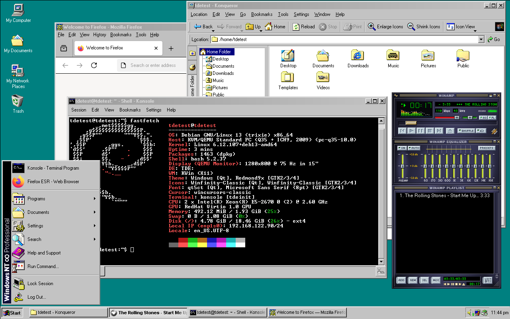
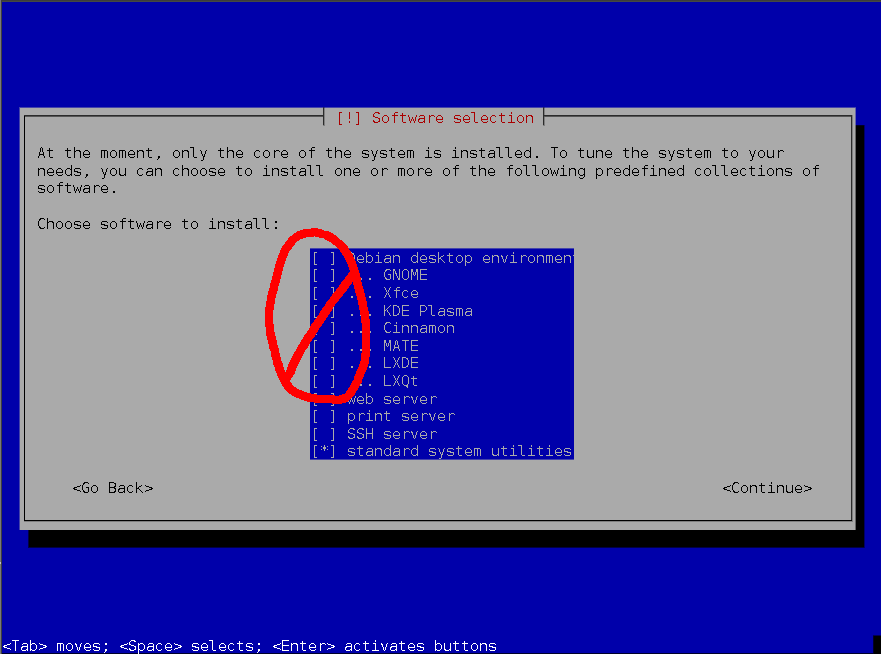

# Winfinity Installer

## Debian Instructions:
1. Install Debian 13 "Trixie" without a GUI using minimal/netboot iso (https://www.debian.org/CD/netinst/). De-select all Desktops on the tasksel screen (leave standard system utilities).

2. After installing Debian, on first reboot, you will be greeted with a text login prompt. If you set a root password, log in as root, otherwise log in as the user you created. I have actually found it easier to administer with a root account so I recommend setting a root password.
3. Create all intended users if you have not already.
4. Clone the winfinity source and change into that directory. Try to make sure all parent directories do not contain a space.
`git clone --recurse-submodules https://github.com/rn10950/winfinity.git winfinity-source`
5. Change your shell into the winfinitysource directory. Run ./debian13.sh as root (or with sudo) and follow instructions.
	- NOTE: Debian does not install sudo by default if a root password is set. Log in as root and run |apt install sudo| followed by |usermod -aG sudo [your username]| to enable sudo. I usually do the entire install logged in as root and then log in as my user for the first time once the GUI is installed.

### Debian 13 bootstrap installer:
For ease of use on testing systems or VMs, a bootstrap script is provided. It is not recommended to do it this way on production systems, instead clone manually. Run this single-line command from a newly installed Debian 13 CLI-only prompt logged in as root:
`wget -qO- https://raw.githubusercontent.com/rn10950/winfinity/master/scripts/debian13/bootstrap.sh | bash`

# PFAQ (Potentially FAQ)

## What is your goal?
What Windows 98 or 2000 would have been if they were built on Linux. I am trying to create a seamless experience as similar as possible to classic Windows, while keeping in mind that Winfinity is running on a modern Linux distribution used for the kind of productive work this UI was so well designed to do.

## Why Trinity?
All of the Windows clones I have found over the many years I have been trying to find one are an approximation of what a Windows-like interface could look like, confined by the many limitations of whichever modern DE is commonly available. Making modern software, using different and constantly changing widget libraries, remain consistent was also a challenge-- especially considering many of the DEs use said widget libraries. Trinity provides a unique environment that extensively resembles Windows out of the box and uses its own widget library, which is a good foundation for handling the more frequently changing aspects of modern software. Trinity also provides ways to expand the default configuration in more productive ways, such as virtual desktops and multi-monitor setups, while not feeling out of place.

## Trinity is based on an ancient KDE version, how can I do anything other than play around with it?/Doesn't Konqueror use a web engine so old it's useless?
It is true that Trinity Desktop is based on very old code. However, TDE is only your graphical desktop-- not your kernel, core system utilities, or browser. Most of the applications provided by TDE are (seemingly unknowingly to Microsoft) timeless. With the exception of web browsers, most of the basic things people expect pre-installed on a computer are stable. A calculator, text editor, basic paint program, PDF/Image viewer, media player, terminal, and file manager doesn't change all that much. While Konqueror may have an old HTML and JavaScript engine, the network libraries that actually matter get updated. I wouldn't use Konqueror as a web browser these days anyway-- just like you wouldn't use IE on Windows XP in the later years (if at all). Winfinity's goal is to provide all those basic things while setting up a proper platform for newer software to "play nice".

## Why Debian?
Debian was chosen as a primary target because it provides relatively stable "versions", reducing the chance that you will update your PC expecting security updates and getting a UI redesign. This is the same reason Firefox ESR is the Firefox installed if chosen from the menu.

## Why does Winfinity explicitly target Debian 13? Why not testing or sid?
Debian 13 "Trixie" is the current stable version of Debian, and the one I run on my PCs. The install system is set up to allow multiple scripts for various versions of Debian (and potentially other distros) to coexist. I decided to separate each Debian version into a separate script because there are often changes between versions that break how repositories are set up and which packages need to be installed. It is also important to make sure the Trinity repositories have caught up to the new version. I will start copy-and-modifying a Debian 14 script once the release date nears (estimated sometime in summer 2027) and Trinity binaries are available.

## Porting to other distros
Users are more than welcome to submit pull requests for install scripts ported to other distros as long as they don't break the Debian version. Please use the Debian install scripts as templates, as they install the right dependencies and set the right variables. winfinity-install.sh is intended to be the distro independent installer that installs Winfinity-exclusive things. It assumes Trinity and all other dependencies are installed and requires a shell script that sets variables, passed as $VARS, which the Debian install script provides an example of how to create. Unfortunately, at this time, the documentation does not reflect the full capability of the install system using variable switches. In your install script, define a clear distro and version string to ensure compatibility-- set $OS_TYPE to it (the default is "debian13"). Create a subdirectory under /scripts/OS_TYPE named as your version string and place all your scripts there. If you would like, you can place lists of packages in /packages/OS_TYPE/ and process them how you wish, providing a platform to create different "sub-distros" of Winfinity. The default list of packages installed is located in /packages/debian13/default.txt.

## Who is Winfinity for?
Anyone who wants their PC to prioritize productivity and multi-tasking over eye-candy, or those nostalgic for old versions of Windows. It should theoretically work on older or slower computers as well.

## Can I use Winfinity as a daily driver?
Yes! I have been using TDE (with alpha-Winfinity) for over 5 years and the only software limitations I have run up against were those of the Ubuntu 18.04 LTS OS the old version of Winfinity was built on. The current Debian version of Winfinity was tested for several weeks on bare metal as my daily driver before posting, fixing the various issues that only made themselves known in such cases. At the time of publishing, I have officially replaced Ubuntu with Debian using this version.

## Why did you spend so much time making this?
I've always thought that the UX found in Windows from Windows 98 to Windows XP was the most productive desktop UX ever made for power users. It is very resource-thrifty while boasting a highly customizable visual style that presents UI elements in a highly visible, productive fashion. Starting with Windows Vista, the changes made to cater to home users and provide eye-candy made more advanced tasks more difficult. In my opinion, these changes were revertible and/or tolerable until Windows 8.x. Seeing the writing on the wall in the mid-late 2010s, especially considering the SaaS direction Microsoft was and is going in, I decided I would ride out Windows XP x64 as long as I could while working on a Linux-based replacement. I moved to Linux full time around 2019-2020, using a very early version of Winfinity, while gradually improving it. It is now time to reinstall my system, and I have finally managed to make Winfinity portable enough to share.

### Buh, Windows XP had the Fisher-Price theme, buh
Yes, it did, but all of the UX "improvements" in XP were revertible. Even the icons and bitmaps if you knew how to use reshacker. Windows XP x64 may as well be 64-bit Windows 2000.

## What took so long?
I can be a perfectionist sometimes. TBH, you guys are getting a compromise version not up to my standards because I needed to upgrade my PC. See: known issues.

## Q4OS is based on Debian and TDE, why didn't you use that?
Q4OS is what introduced me to Trinity as a viable platform for what I was trying to do. To give the Q4OS project the most benefit of the doubt, I came to this conclusion back in 2019 and have not tried Q4OS since. When trying Q4OS out, I loved how it looked, but I felt that it tried to emulate how Windows installs packages to the point that it complicated the Linux side of things. I then set out to try to do something similar using vanilla Debian and official repos. Unfortunately, the Trinity Desktop project repository needs to be added manually as the Debian repos do not carry Trinity. The Winfinity installer also adds the mozilla.org repository if Firefox is chosen to be installed. In my experience, this is one area where the newest packages are needed but the official repos can lag behind. If you would rather install from a Debian.org repository, install Firefox from a terminal later.

## Why "Windows NT" Infinity?
Windows NT originally stood for "Windows New Technology" which fits perfectly for a Windows-classic inspired desktop environment based on a "newer" technology. The "Infinity" reflects the Linux core that will infinitely improve while the UI remains consistent.

# Future Ideas

## Expanded theming support (Windows PLUS)
The "Winfinity Control Panel" in the settings menu is a sister project. As of now, it provides the most basic color scheme support in the style of DESK.CPL, with limited support for importing a Windows .theme file. The good news is that it, and the rest of the winfinity-config submodule, can be updated separately. Run |sudo git -C /opt/winfinity/winfinity-config pull| to update.

## Windows XP (Luna) Theme
Provisions were left in directory naming schemes to allow the eventual addition of a Windows XP theme. This would entail finding a great XP icon pack, TQt/Qt5-6/GTK2-3-4 widget themes, a start menu, and adding support in winfinity-config for switching. If done correctly, it would probably be the most accurate XP Linux theme out there, as Konqueror nails XP's Explorer.

# Known Issues

- I have not found a way to change the cursor or titlebar theme in TDM (login manager).
- It is impossible to change the taskbar clock to have uppercase AM/PM like Windows
- It is impossible to change title text fading out in taskbar buttons to the ellipses used in Windows.
- Winfinity Control Panel's color themes do not currently apply to Qt5/6 or GTK4. Font changes do not work at all. These features have been held back because the control panel GUI was originally written during a time when Python 2 was long depreciated but TQt was not ported to Python 3 yet. Therefore the code had to be hacky to begin with and only got worse when upgrading to Python 3. In the future, there will be a winfinity-config update that completely rewrites the theming system adding these features and more.

# Development Info and Custom Modules
## Adding a module:
1. Create new containing folder under `custom-modules/` for project
2. Create an executable file called install.sh, which will be the script to install your module. On execution, install.sh will be passed $VARS, which is a path to a script to be sourced. Several variables will be set by the install system when called, please see an incomplete (but fully functional) list below. Including the following at the top of your script should set everything up:
    [[ -z $VARS ]] && exit 1
    source $VARS

## Installing files via script:
When creating modules, use your install script to copy files. Please use the included variables as a prefix for all locations. Winfinity install system is designed to primarily use absolute paths. All files in $HOME_DIR will be copied to the selected user's home on install, and $ROOT_DIR systemwide (with superuser). Please do not target root or a user's home directory manually. The install system will place all files where they need to go, and creates a template user. Use the system's built in $USER and $HOME environment variables within copied files to ensure a portable profile.

## Variables passed to each install.sh:
Each install.sh is provided $VARS. Source $VARS in your script, and among the variables declared are:

**mD** - The root directory of your module relative to the system root. Always use this when working with files in your module.

**TDE_SYS_DIR** - The directory TDE is installed in (usually /opt/trinity)

**SYS_FONT_DIR** - System-wide font directory (/usr/local/share/fonts)

**SYS_ICON_DIR** - System-wide icons directory (/usr/share/icons)

**SYS_THEM_DIR** - System-wide GTK+ themes directory (/usr/share/themes)

**sD** - System-wide Winfinity directory (/opt/winfinity)

**optF** - Text file list of optional features chosen during install

**WINFINITY_SOURCE_DIR** - Winfinity source directory (root-relative)

**ROOT_DIR** - Target this directory as you would system root

**HOME_DIR** - Target this directory as you would a user's home. Please do not target a user home directly.

**INSTALL_SYS** - Boolean: 1- Running as root and installing system-wide, 0- Installing in a user profile

**INSTALL_WINE** - Boolean: 1- Winfinity installer is also installing Wine, therefore it and Winetricks will be present. 0- Wine is likely not present.

**TDE_PROP** - Boolean: Use Windows icons and sounds

**WINF_FIRSTRUN** - Path to a shell script that will run on each user's first TDE start. 

**WINF_AUTOEXEC** - Path to a shell script that will run on every TDE start.

**WINF_USERS** - A comma-separated list of all users for which Winfinity is to be installed.

**OS_TYPE** - Reports which OS Winfinity is installed on. EX: $OS_TYPE == "debian13". This is set by the distro-specific install script you install Winfinity from.

#### Special installer target directory variables: (please use these first if possible before using above directories)

**WINF_INSTALL_PREFIX** - Targets the winfinity program directory regardless if installed system wide or in user profile. Place all shared resources here. (/opt/winfinity or ~/.winfinity)

**TDE_INSTALL_PREFIX** - Targets the TDE program directory regardless if Winfinity is installed system wide or in user profile. Place all shared resources here. (/opt/trinity or ~/.trinity)

**WINF_USER_INSTALL_PREFIX** - Always targets the user's ~/.winfinity directory. Place all user-specific files here (e.g. config files)

**TDE_USER_INSTALL_PREFIX** - Always targets the user's ~/.trinity directory. Place all user-specific files here.

## $WINF_FIRSTRUN and $WINF_AUTOEXEC
Winfinity installer provides two template shell scripts for modules to append to for execution on TDE start. firstrun.sh runs on the first run of a new user starting Winfinity, while AUTOEXEC.sh runs every time. To add to these scripts, simply append using echo. Please be sure to use environment variables for all user paths ($USER, $HOME, etc), and remember to escape all variables 

Examples:
    echo "mkdir -p \"\$HOME/Movies\"" >> $WINF_FIRSTRUN
    echo "/bin/xeyes" >> $WINF_AUTOEXEC
